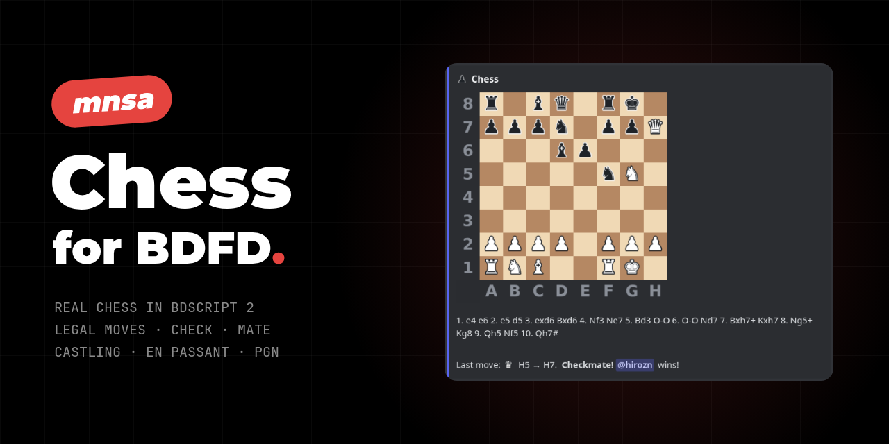
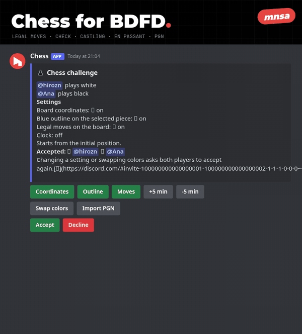

<p align="center"></p>

# Chess for BDFD

A complete chess game for [Bot Designer for Discord](https://botdesignerdiscord.com), written in BDScript 2.
Two players, one embed, everything with buttons.

- **Real chess rules:** legal moves only, check, checkmate, stalemate, castling, en passant and promotion (you pick the piece).
- **Board made of emojis**, with optional coordinates, a blue outline on the selected piece and the legal moves drawn on the board (`E4`, `H1`…).
- **Challenge screen:** both players see the colors and the settings, and the game starts when both accept. Swap colors, change settings, or decline.
- **PGN export:** every move is written in chess notation (`Nbd2`, `exd6`, `e8=Q`, `O-O`, `Qh4#`). The PGN shows up when the game ends.
- **PGN import:** paste a game from lichess or chess.com (headers included) on the challenge screen and the game continues from that position.
- **Against a bot:** challenge a bot and you play both sides.
- **No variables for the game:** each game lives in its own message (an invisible link at the end of the board keeps the state), so a channel can have several games at once.
- **Clock:** +5 / −5 min buttons on the challenge screen (up to 600 min per player), +2 s per move. Whoever runs out of time loses.
- **Works without custom emojis:** with `ChessEmojis` empty the board uses standard emojis and the challenge screen says how to install the real set.

<p align="center"></p>

## Files

| File | Trigger | What it does |
|---|---|---|
| `commands/chess.bdscript2` | any, e.g. `!chess` | `!chess @user` opens the challenge. `!chess emojis ID1 ID2 ID3` builds the `ChessEmojis` line from the emojis of your own servers. |
| `oninteraction/chess.bdscript2` | `$onInteraction` | Every button and the PGN form. Buttons from other commands are ignored. |
| `emojis/` | | The 143 emojis the board uses. |
| `tools/upload-emojis.mjs` | | Uploads the emojis to your bot and prints the `ChessEmojis` value. |
| `site/` | | The same upload as a web page (English and Portuguese, works on phones) and a small server for it. |

Use any trigger you like for `commands/chess.bdscript2` (the examples use `!chess`). The subcommands come right after it.

## Variables

Create these in the **Variables** tab of the BDFD app, with these default values:

| Variable | Default value | What it holds |
|---|---|---|
| `ChessEmojis` | the output of the script | The chess emojis as name and ID pairs (see below). |

The game itself needs no variable: it lives in its own message. The end of the board's description has a link with invisible text (`[⠀](https://discord.com/#…)`) that holds the state, the board with the legal moves, the time of the last move and the PGN; the buttons read it back with `$getEmbedData`. So a channel can have several games at once. A game with no move for 15 minutes expires. With the clock on it never expires: whoever runs out of time loses. A server admin (Manage Server) can end any game with the Resign button.

## Emojis

The code reads the emojis from `ChessEmojis`: name and ID pairs separated by spaces. Each name becomes the emoji `<:name:ID>`, so the IDs can be application emojis (recommended) or emojis of a server the bot is in.

**On your phone (no computer):** use the web tool in `site/`. Paste your bot token, it uploads the 143 emojis to your bot and gives you the `ChessEmojis` line. The token only goes through the server during the upload and is never stored or logged; reset the token afterwards and update it in BDFD. To host it yourself: `node site/server.js` (Node 18+), then open http://localhost:8790.

**On a computer:** **Application emojis.** Discord lets a bot own up to 2000 emojis that work in any server, with no emoji server needed. Run:

```
node tools/upload-emojis.mjs YOUR_BOT_TOKEN
```

The script uploads the 143 PNGs to your bot (the same bot BDFD runs) and prints one long line like `1k 123… 1kc 456… …`. Paste that line as the default value of `ChessEmojis`. You need Node 18 or newer. The token only goes to discord.com.

**By hand (no token, no script):** download the 143 PNGs from the `emojis/` folder and upload them yourself in **Server Settings → Emoji**. A server without boosts holds 50 emojis, so you need 3 servers (or boosted ones), and your bot has to be in all of them. Keep the file names as the emoji names (`1kc`, `vc`, `dA1`…).

Then get the IDs: send `!chess emojis ID1 ID2 ID3` with the IDs of those servers (right-click the server icon → **Copy Server ID**, with Developer Mode on in Discord's Advanced settings). The bot reads the emojis of those servers and replies with the `ChessEmojis` line, ready to paste. To check a single emoji by hand, type `\:1kc:` in any channel: Discord shows `<:1kc:123456789…>`, and the number is the ID.

| Emoji | Meaning |
|---|---|
| `1k` `2p`… | Piece without background, used on the buttons. `1` is white, `2` is black. `k` king, `q` queen, `r` rook, `b` bishop, `n` knight, `p` pawn |
| `1kc` / `1ke` | Piece on a light / dark square |
| `1ksc` / `1kse` | Selected piece: blue, framed by the square color |
| `vc` / `ve` | Empty light / dark square |
| `dA1` … `dH8` | Square the selected piece can move to, with its name |
| `x1`…`x8`, `xa`…`xh`, `x0` | Coordinates around the board and the empty corner |

## How it works

BDFD has no loops, so the code writes its own code and runs it with `$eval`, and `$eval` cannot run inside another `$eval`. Three tricks make chess fit:

1. **Mailbox board.** Each square is a number: `10 × row + column + 10` (a8 = 21, h1 = 98). Moving is adding: a rook steps ±1 and ±10, a bishop ±9 and ±11, a knight ±8, ±12, ±19, ±21. Stepping off the board lands on a number that is not a square, whose variable is empty, so there is no edge check. During a command the board lives in variables `q21`…`q98`.
2. **Moves are computed once per move.** After every move the bot computes all legal moves of the side to move and stores them with the board (`1p:75>65` is a pawn that can go to E3 or E4). Selecting a piece and showing its moves is just reading. Zero moves means checkmate (if in check) or stalemate.
3. **Check from the king's lines.** One pass over the pieces of the side that just moved marks the attacked squares, counts checks and finds pinned pieces (the first piece on a rook, bishop or queen line with the king right behind it). A pinned piece only moves along its line. In check, only moves that capture the checker or block it count. In double check, only the king moves.

Importing a PGN does not need legal moves: the move already says where the piece went (`Nf3`), and the bot only finds *which* knight by looking backwards from F3. That fits a whole game in a single `$eval`. The legal moves are computed once at the end.

## Limits

- No draw by repetition, by the 50-move rule or by insufficient material.
- PGN comments in `{ }` are not supported.
- PGN import: up to 140 half-moves. Longer games are refused with a message.
- The PGN kept in the message holds 1000 characters. In a very long game it ends with ... and stops growing; the game goes on.
- Without the clock, a game with no move for 15 minutes expires. With the clock it never expires: whoever runs out of time loses.
- `oninteraction/chess.bdscript2` ships without comments: with them it goes over BDFD's 65,000-character limit for a command. The command file keeps its comments, and this README explains the rest.
- In the rare case where two identical pieces can reach the same square, one of them is pinned and the PGN does not say which one moved, the import takes the first one.
- BDFD limits that shaped the code: `$repeatMessage` repeats at most 10 times, `$eval` refuses more than 60,000 characters, `$cropText` needs all 3 arguments, and text inside `$c[...]` is still parsed (no `$` in comments). Big loops are built 10 at a time and run in several `$eval`s.
- More BDFD behaviors found while testing: a variable holds at most 499 bytes (not letters) when set by code; two `$eval`s with the exact same text in one run only run once (so every `$eval` here starts with a different `$c[N]`); buttons in a reply are added to the buttons already on the message, so each screen starts with `$removeButtons`; an embed field with an empty or invisible name makes the whole reply fail silently; and `$json` returns big numbers in scientific notation (`1.79e+09`), so timestamps are stored as text. A markdown link with an invisible text in an embed description shows nothing, but `$getEmbedData` returns it whole: that is where the game is stored.
- In the `$eval` loops, every `|` is removed from the code before it runs (that is how the `$|` escapes work). Keep that in mind if you add text with `|` inside those loops.
